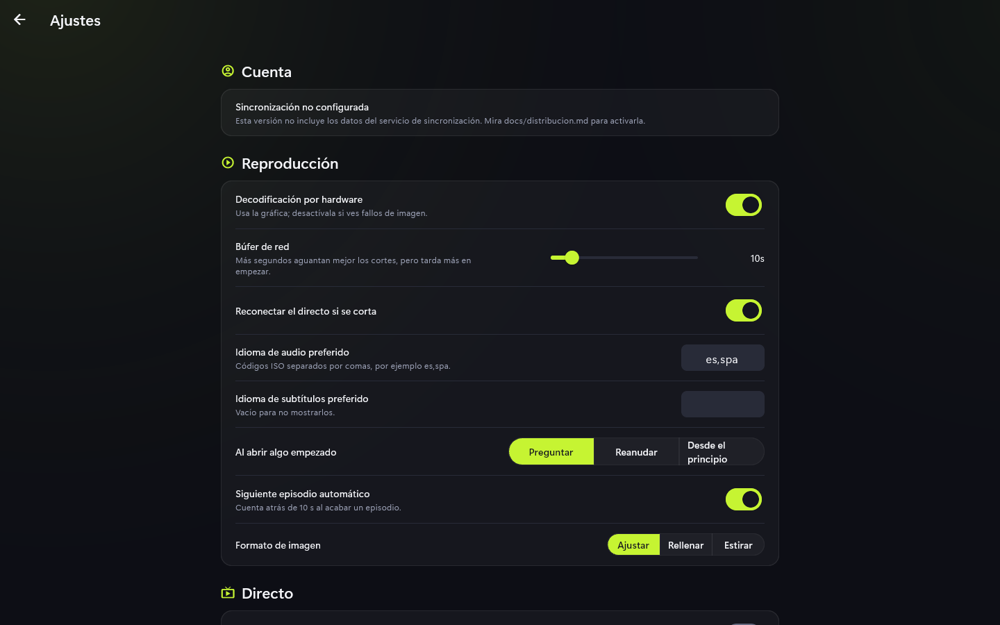
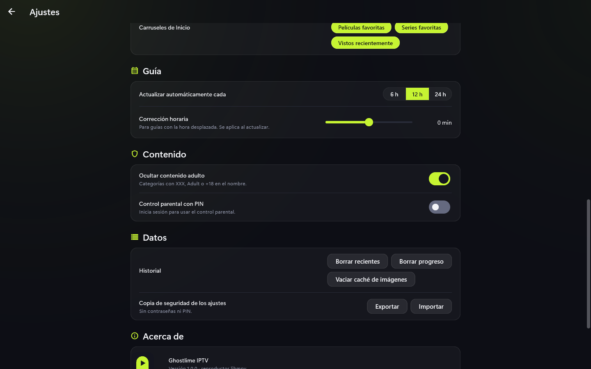

# Ajustes

Se abren con el engranaje de la barra lateral o de Listas. Los cambios se aplican al
momento, sin botón de guardar.

## Secciones

- **Cuenta**: sincronización opcional, **Exportar mis datos** y **Borrar mi cuenta**
  (ver [Cuenta y sincronización](cuenta-y-sincronizacion.md)).
- **Reproducción**: decodificación por hardware, búfer de red, reconexión del directo,
  qué hacer al abrir algo empezado y siguiente episodio automático. El audio y los
  subtítulos son los que el canal o el vídeo traen por defecto, y la imagen se ajusta
  siempre a la pantalla sin recortarla ni deformarla.
- **Directo**: "Sonido en la vista previa" y "Formato de las listas nuevas" (TS o HLS).
  Los canales se llaman como los nombra el proveedor.
- **Interfaz**: "Al abrir una lista, ir a", "Abrir la última lista al arrancar",
  "Tamaño de los pósteres" y "Carruseles de Inicio" (cuáles se muestran).
- **Guía**: cada cuánto se actualiza (6, 12 o 24 h) y corrección horaria en minutos.
- **Contenido**: ocultar contenido adulto y control parental, que necesita una cuenta
  iniciada (ver [Control parental](control-parental.md)).
- **Datos**: borrar recientes, progreso y caché de imágenes, y la copia de seguridad
  (ver [Exportar e importar](exportar-importar.md)).
- **Acerca de**: versión y licencias.

## Consejos

- "Borrar progreso" no se puede deshacer.
