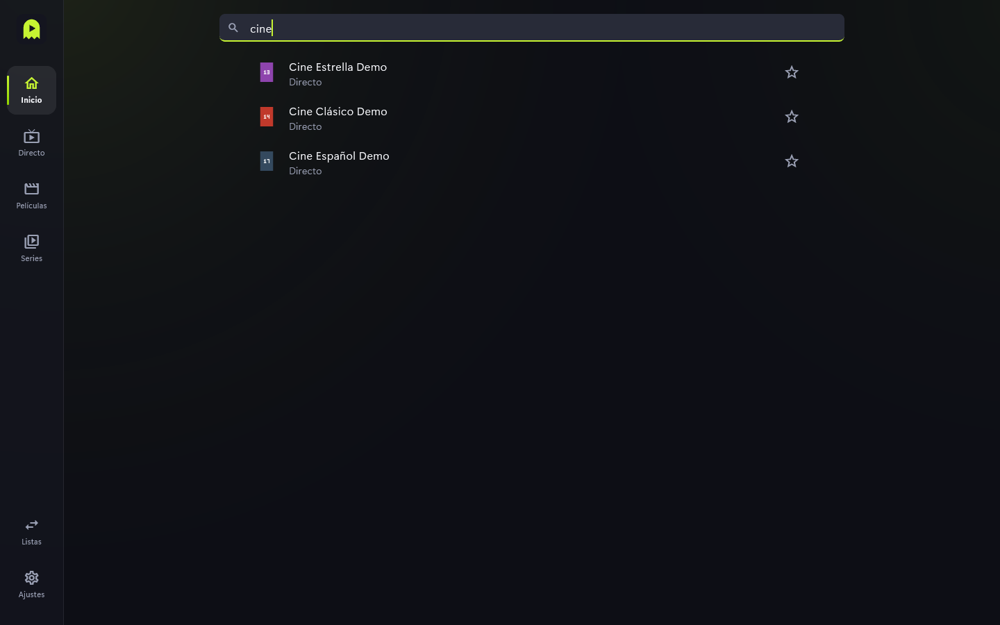

# Búsqueda

Para encontrar canales, películas y series de toda la lista sin navegar por categorías.

## Pasos

1. Ve a **Inicio**. La barra de arriba dice "Buscar en directo, películas y series".
2. Escribe unas letras. Los resultados aparecen al momento, indicando si son de
   Directo, Películas o Series.
3. Pulsa un resultado para abrirlo. Los canales de Directo llevan una estrella para
   añadirlos a favoritos; las películas y series se marcan como favoritas desde su ficha.

## Consejos y límites

- La búsqueda no distingue mayúsculas ni acentos: "cine" encuentra "Cine Clásico".
- Si buscas solo dentro de una sección, usa su campo **Filtrar**.
- Los resultados respetan el control parental: las categorías bloqueadas no salen hasta
  desbloquear con el PIN.
- Los canales se llaman igual que en Directo: con el nombre del proveedor, y con " · 2",
  " · 3"… cuando se repite el nombre en un grupo.
