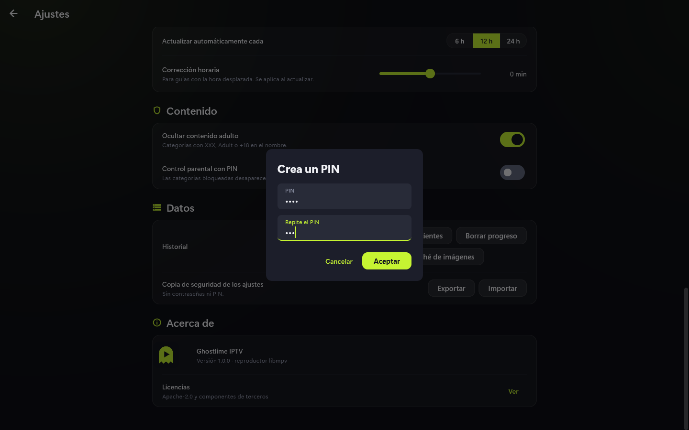
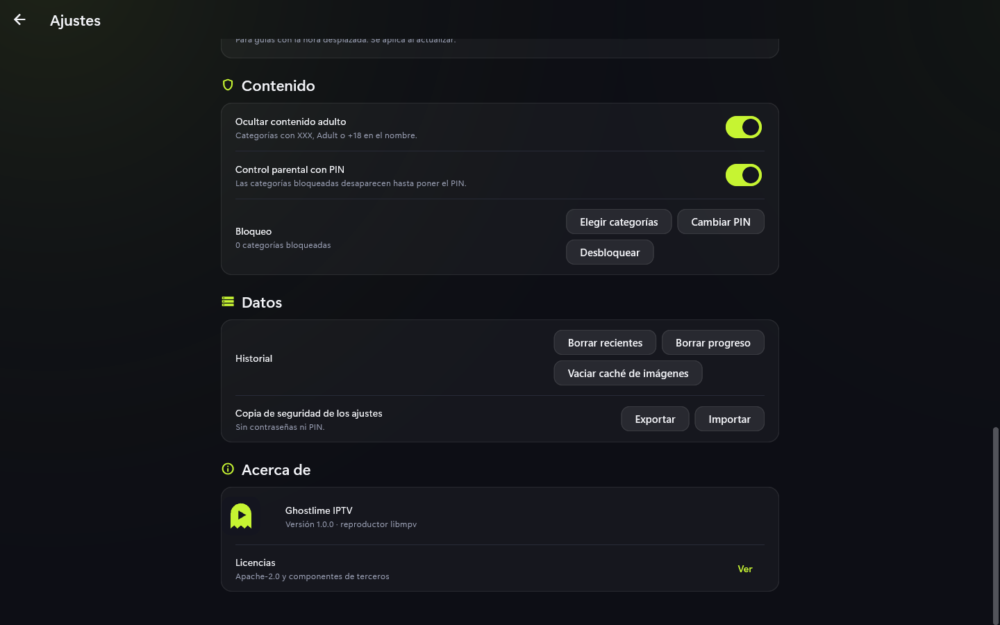

# Control parental

Oculta categorías con un PIN para que no aparezcan hasta desbloquear.

## Pasos

1. En **Ajustes** > Contenido, activa **Control parental con PIN**.
2. Crea el PIN y repítelo; **Aceptar** lo guarda. Si no coinciden, se avisa.

   

3. Pulsa **Elegir categorías** y marca las que quieras bloquear.
4. Desde ese momento esas categorías desaparecen. Para verlas, pulsa **Desbloquear** e
   introduce el PIN.

## Ocultar contenido adulto

El interruptor **Ocultar contenido adulto** quita las categorías con XXX, Adult, +18 y
similares en el nombre. Mientras el control parental está activo, no se puede cambiar sin el PIN.

## Consejos y límites

- El PIN y las categorías bloqueadas **no salen del dispositivo**: no se sincronizan ni
  van en las copias de ajustes, y un fichero importado no puede saltarse el PIN.
- Si olvidas el PIN no hay forma de recuperarlo desde la app.
