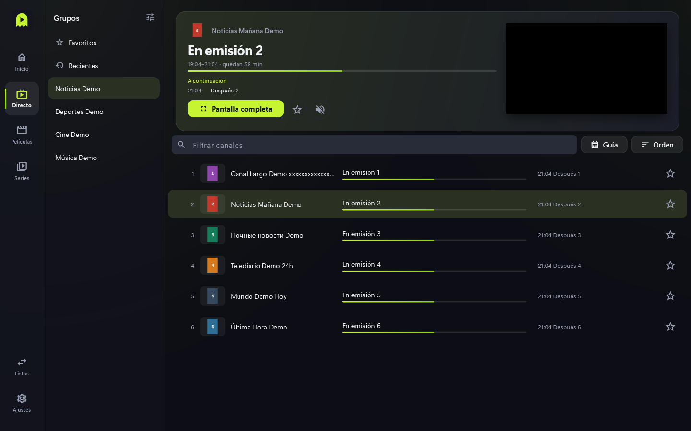
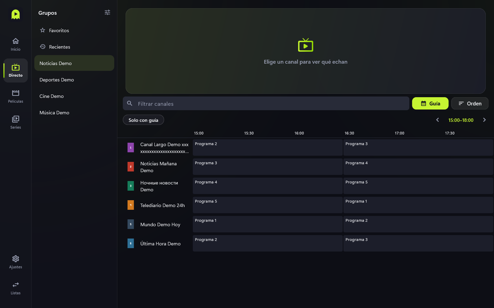

# Directo y guía

Para ver canales en vivo, con una vista previa y lo que echan ahora y después.

## Pasos

1. Entra en **Directo**. A la izquierda están los grupos (categorías), con **Favoritos**
   y **Recientes** arriba.
2. Elige un grupo y pulsa un canal. Arriba se abre la vista previa con el programa en
   emisión, su progreso y el siguiente.
3. Pulsa **Pantalla completa** para verlo en grande (ver [Reproductor](reproductor.md)).
4. La estrella marca el canal como favorito.
5. Usa **Filtrar canales** para buscar dentro del grupo.

## La guía

El botón **Guía**, junto a **Orden**, cambia entre dos formas de ver la programación:

- **Desactivado**: la lista de canales con el programa actual y el siguiente. Al
  seleccionar un canal, su horario aparece en el panel de arriba.
- **Activado**: una cuadrícula con la programación del grupo actual. Usa las flechas
  para avanzar o retroceder en el tiempo y **Solo con guía** para ocultar canales sin
  programación.

## Consejos y límites

- La guía se actualiza sola cada 6, 12 o 24 horas (en **Ajustes**). También puedes
  pulsar **Guía** en la pantalla Listas para actualizarla a mano.
- Si los horarios salen desplazados, usa la corrección horaria de **Ajustes**.
- Los canales sin guía muestran solo su nombre.
- Las filas separadoras del proveedor (del tipo "##### ES - … #####") se ven como
  canales normales.
- Los títulos de los programas dependen de la guía del proveedor.
