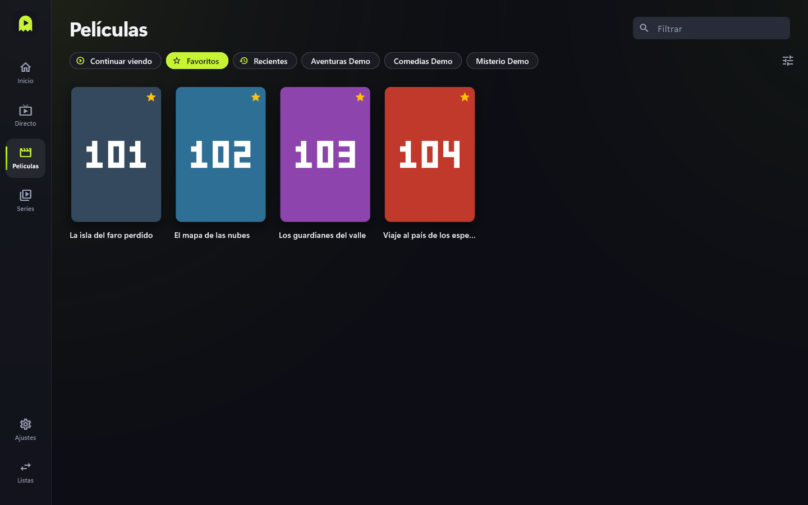
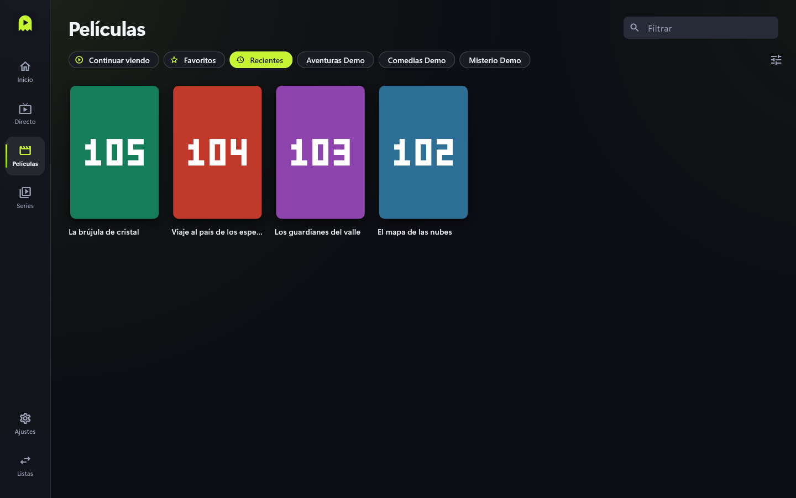

# Favoritos y recientes

Atajos a lo que más ves.

## Favoritos

1. Pulsa la estrella de un canal, o **Favorito** en la ficha de una película o serie.
2. Encuéntralos en el grupo **Favoritos** de Directo, en el atajo **Favoritos** de
   Películas y Series, y en los carruseles de **Inicio**.

## Recientes

Lo último que has abierto se guarda solo. Está en **Recientes** (en Directo, Películas
y Series).

## Consejos y límites

- Favoritos y recientes sobreviven a actualizar la lista: se guardan por una clave
  estable de cada canal o título.
- En **Ajustes** > Datos puedes **Borrar recientes** o **Borrar progreso**.
- Con una cuenta, los favoritos se sincronizan entre dispositivos (ver
  [Cuenta y sincronización](cuenta-y-sincronizacion.md)).
- Los canales favoritos pueden salir primero: ver [Ordenar canales](ordenar-canales.md).
