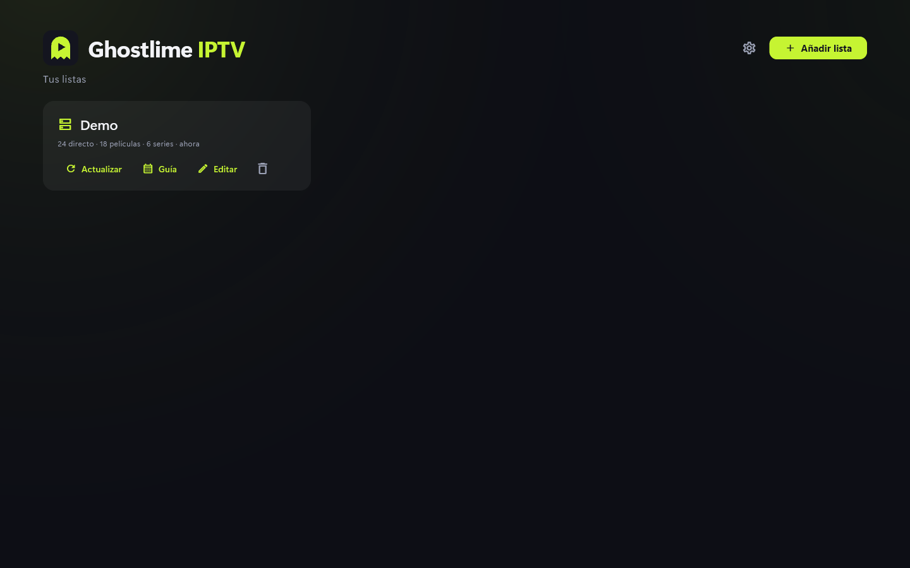
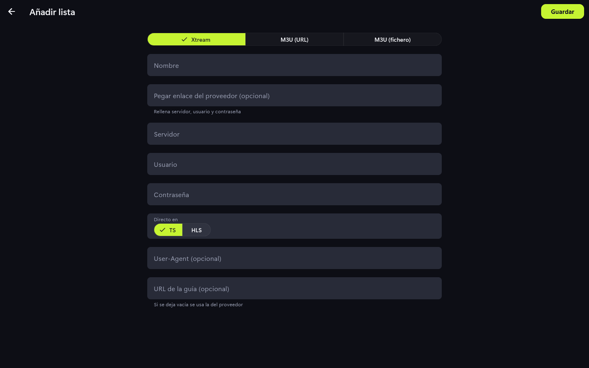
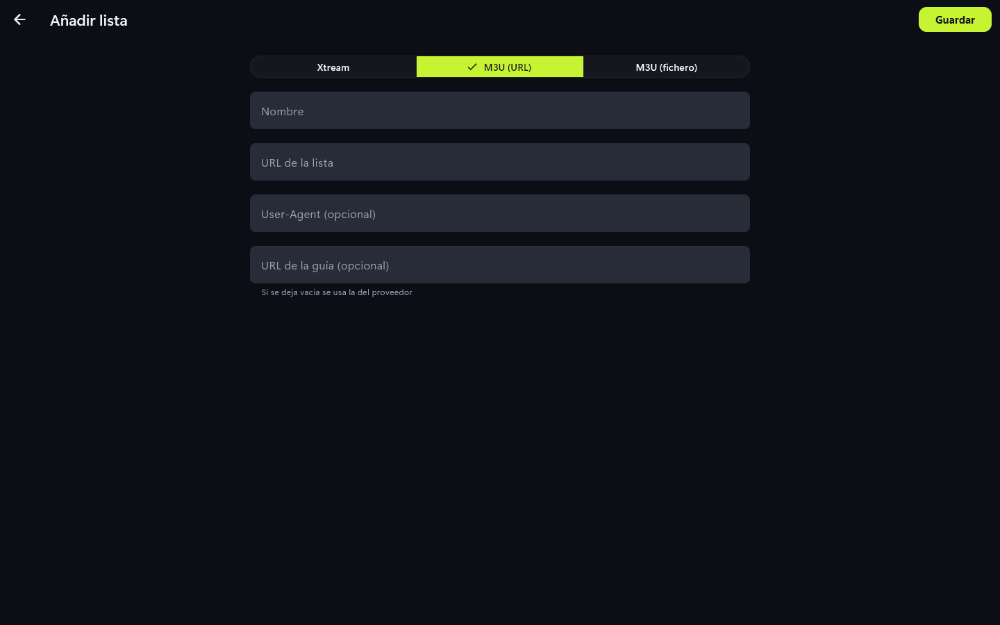
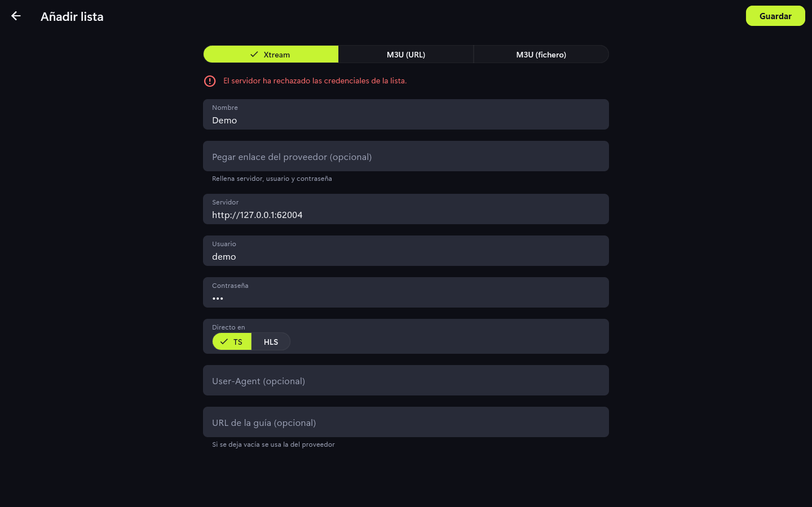

# Listas

Aquí gestionas de dónde sale el contenido. La app no incluye ninguna lista: añade la
tuya.

Cada lista muestra cuántos canales, películas y series tiene y cuándo se actualizó, con
los botones **Actualizar**, **Guía** (actualiza la guía de programación), **Editar** y
borrar.

## Añadir una lista

1. En **Listas**, pulsa **Añadir lista**.
2. Elige el tipo: **Xtream**, **M3U (URL)** o **M3U (fichero)**.
3. Rellena los datos y pulsa **Guardar**. La app comprueba la lista y la descarga.

### Xtream

Pon un nombre, el servidor, el usuario y la contraseña. Si tu proveedor te dio un enlace
completo, pégalo en "Pegar enlace del proveedor" y los campos se rellenan solos.
"Directo en" elige TS o HLS según lo que acepte tu proveedor.

### M3U por URL o fichero

Pega la URL de la lista o elige un fichero del disco. En ambos casos puedes indicar la
URL de la guía (EPG); si la dejas vacía se usa la del proveedor.

## Si falla

El formulario muestra el motivo, por ejemplo credenciales rechazadas o servidor caído.
Corrige los datos y vuelve a guardar.

## Consejos y límites

- Algunos proveedores solo admiten una conexión a la vez: cierra otros reproductores
  antes de ver algo aquí.
- Si un proveedor bloquea el cliente por su User-Agent, puedes poner uno propio en el
  campo opcional.
- Las contraseñas se guardan en el almacén seguro del sistema, no en claro.
- Borrar una lista elimina también sus favoritos, recientes y progreso.
