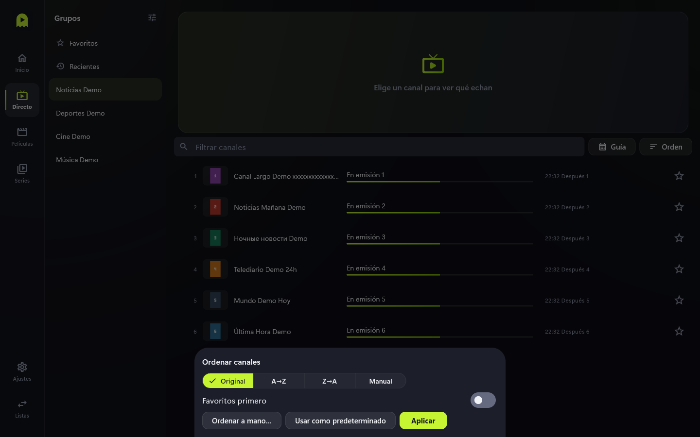
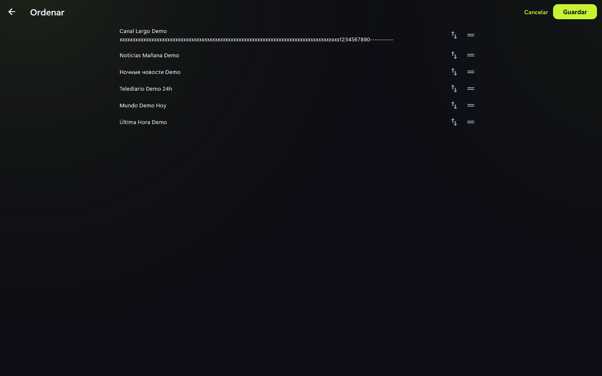

# Ordenar canales

Cada categoría puede tener su propio orden.

## Pasos

1. En **Directo**, elige un grupo y pulsa **Orden**.
2. Escoge: **Original** (el del proveedor), **A→Z**, **Z→A** o **Manual**.
3. Activa **Favoritos primero** si quieres tus favoritos arriba.
4. Pulsa **Aplicar**. **Usar como predeterminado** lo aplica a los grupos que no tengan
   un orden propio.

## Orden manual

1. En el panel, pulsa **Ordenar a mano…**.
2. Arrastra cada canal por el asa de la derecha, o usa el botón de flechas.
3. Pulsa **Guardar** (o **Cancelar** para descartar).

## Consejos y límites

- El orden se guarda por canal, así que sigue valiendo tras actualizar la lista.
- Una categoría sin orden propio hereda el predeterminado.
- Los grupos de Directo, Películas y Series también se pueden reordenar y ocultar con el
  botón de ajustes de la cabecera.
