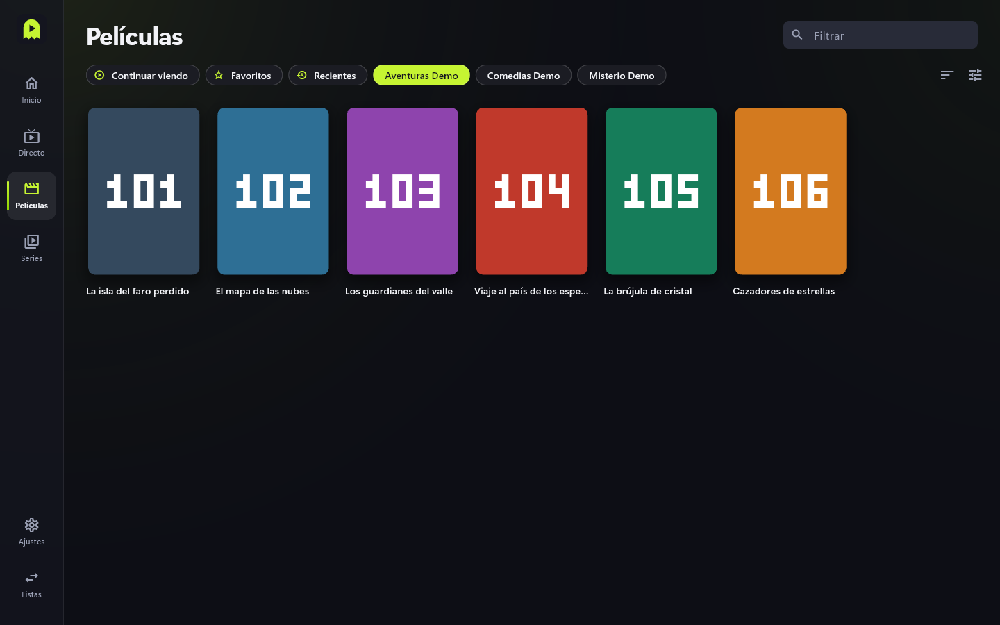
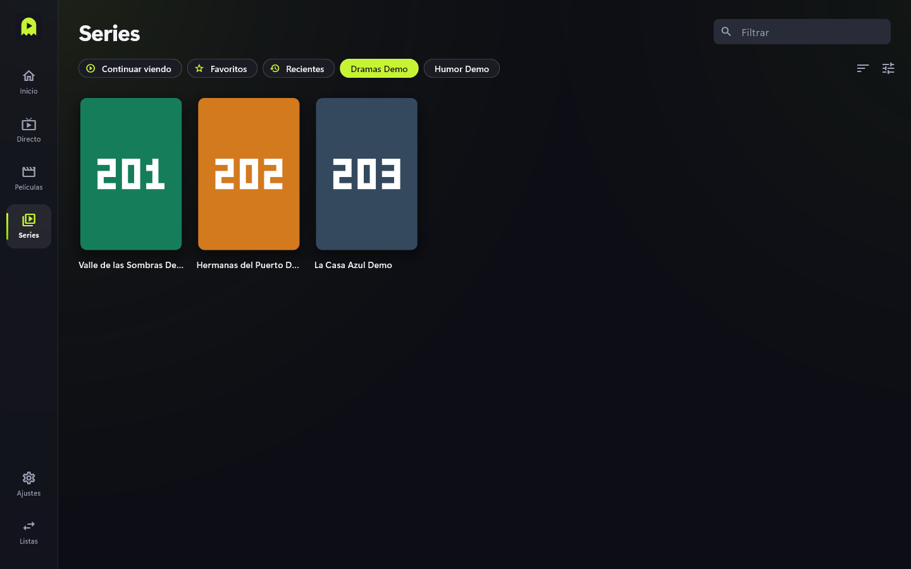
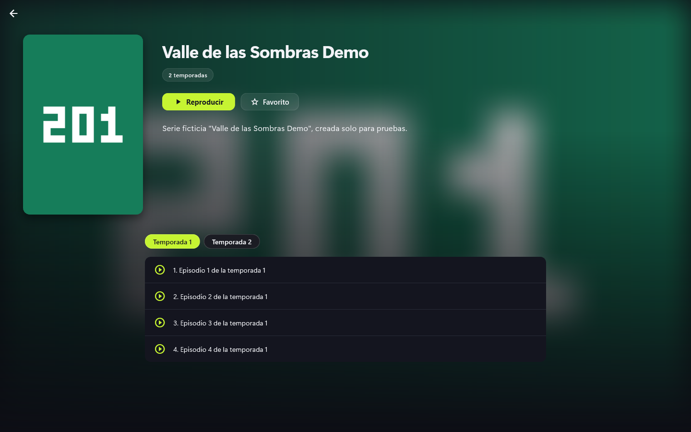

# Películas y series

Catálogo con portadas, fichas, temporadas y "seguir viendo".

## Pasos

1. Entra en **Películas** o **Series**. Arriba hay atajos: **Continuar viendo**,
   **Favoritos**, **Recientes** y las categorías de la lista.
2. Usa **Filtrar** para buscar por título dentro de la sección.
3. Pulsa una portada para abrir su ficha.

## Ficha de película

Muestra duración, nota, reparto y sinopsis cuando el proveedor los da. **Reproducir**
empieza la película; **Favorito** la guarda.

## Ficha de serie

Elige la temporada y pulsa un episodio. **Reproducir** sigue por donde ibas.

## Seguir viendo

Si sales a mitad, la app recuerda el punto. Al volver a abrirlo, según **Ajustes** >
"Al abrir algo empezado", te pregunta, reanuda o empieza de cero. En series, al acabar
un episodio hay cuenta atrás para el siguiente (se puede desactivar). También verás lo
empezado en **Inicio**.

## Consejos y límites

- Las portadas, sinopsis y repartos vienen del proveedor; si faltan, la ficha sale más
  sencilla.
- "Vaciar caché de imágenes" en **Ajustes** libera espacio de portadas.
