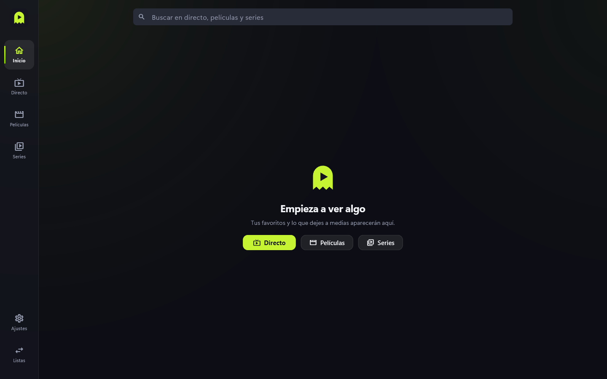
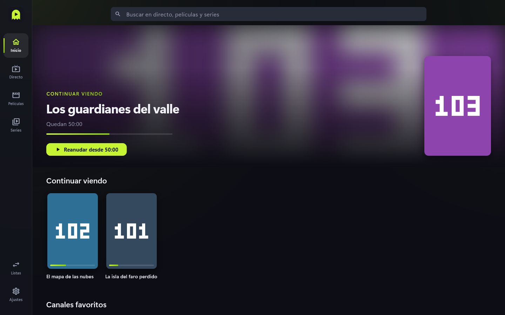

# Primeros pasos

Ghostlime IPTV reproduce las listas IPTV que tú le des. **La app no proporciona
contenido**: ni canales, ni listas, ni películas. Necesitas tu propia lista (Xtream
Codes o M3U) y derecho a verla.

## Qué hay en la pantalla

A la izquierda está la barra de secciones: **Inicio**, **Directo**, **Películas** y
**Series**; abajo, **Ajustes** y **Listas**.

## Pantalla de bienvenida

La primera vez que abres la app aparece la bienvenida. Antes de nada hay que pulsar
**Acepto y continúo**, que acepta los **Términos de uso** y la **Política de privacidad**
(puedes leerlos desde ahí mismo). Hasta entonces los botones están desactivados. Después
eliges cómo seguir:

- **Entrar con email** o **Crear cuenta**, para sincronizar entre dispositivos.
- **Continuar con Google**, solo en versiones compiladas con `GOOGLE_SIGN_IN` (si no,
  aparece desactivado con "Disponible pronto").
- **Continuar sin cuenta**: la app funciona igual, solo en este dispositivo. Puedes
  crear una cuenta más tarde en **Ajustes** > **Cuenta**. Si cambian los términos, la app
  pedirá aceptarlos de nuevo.

Sin servicio de sincronización en la versión, solo aparece **Continuar sin cuenta**.

## Pasos

1. Tras la bienvenida no hay listas: ve a **Listas** y pulsa **Añadir lista**
   (detalle en [Listas](listas.md)).
2. Espera a que se descargue el catálogo. Cuando termine, la lista muestra cuántos
   canales, películas y series tiene.
3. Entra en **Directo**, **Películas** o **Series** y elige algo para reproducir.
4. Lo que veas a medias y tus favoritos aparecerán en **Inicio**.

## Consejos

- Con el buscador de la parte de arriba de Inicio encuentras cualquier cosa de la lista
  (ver [Búsqueda](busqueda.md)).
- Puedes tener varias listas y cambiar entre ellas desde **Listas**.
