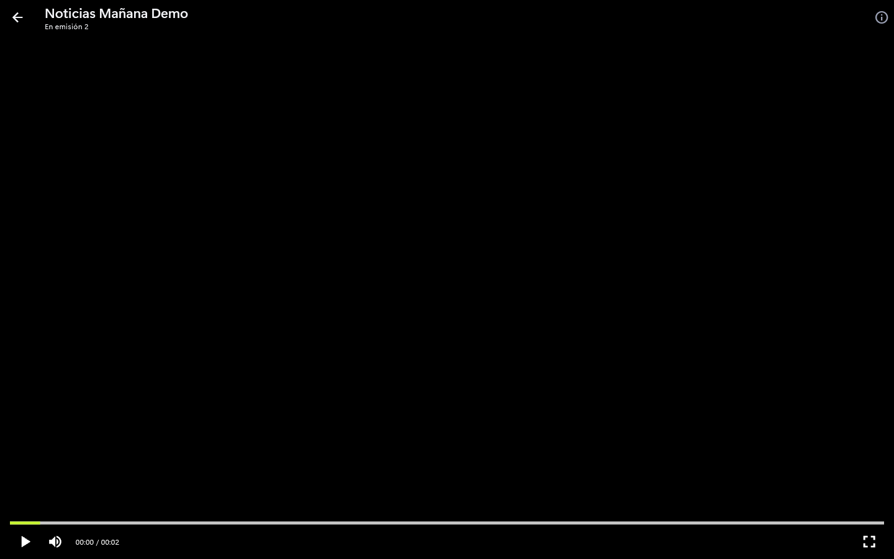
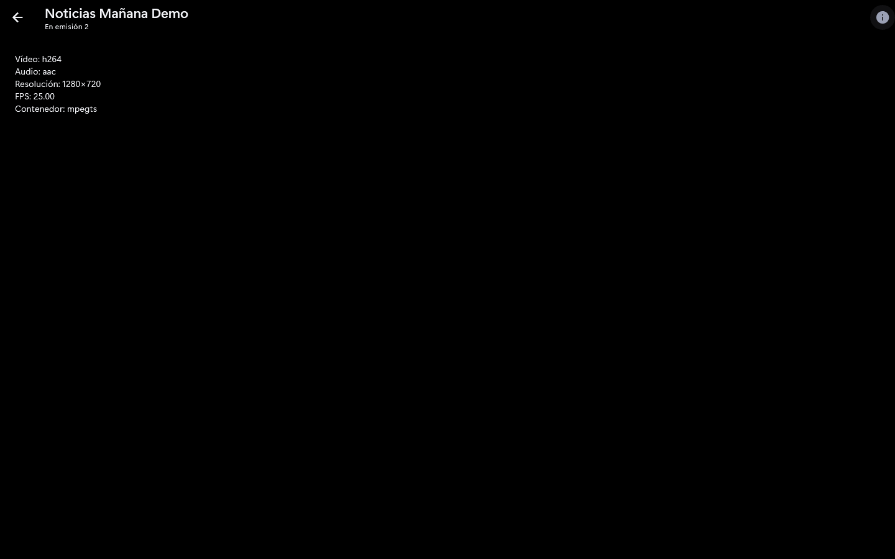

# Reproductor

Usa libmpv, así que reproduce formatos que muchos reproductores web no pueden (por
ejemplo canales HEVC/4K con audio MP2 o AC3).

> Las capturas de esta guía no muestran vídeo real: la imagen se ha sustituido por
> negro y los vídeos de demostración no tienen contenido.

## Pasos

1. Abre un canal, película o episodio (en Directo, **Pantalla completa**).
2. Mueve el ratón para ver los controles: reproducir/pausa, volumen, barra de
   progreso, tiempo y pantalla completa.
3. Pulsa el icono de información (o la tecla **I**) para ver el códec, la resolución,
   los fotogramas por segundo y el contenedor. La línea **Búfer** indica los segundos
   de vídeo en el búfer, la velocidad de descarga, los cortes (veces que se ha parado
   a cargar) y las reconexiones desde que se abrió. En películas y episodios un búfer
   o una velocidad de 0 salen como "—": está todo cargado o se lee del disco.
4. **Esc** o la flecha de arriba a la izquierda vuelven atrás.

## Consejos y límites

- Si el directo se corta, la app reconecta sola (se puede desactivar en **Ajustes**).
- Si un canal o vídeo no empieza a reproducirse en 20 segundos, la app deja de
  intentarlo y muestra "No se ha podido abrir el canal" (o "el vídeo"). La vista previa
  de Directo hace lo mismo.
- Si ves fallos de imagen, desactiva la decodificación por hardware en **Ajustes**.
- Si el canal empieza lento o se entrecorta, ajusta el búfer de red.
- Algunos proveedores solo permiten una conexión: no abras el mismo canal en dos sitios.

## Registro de reproducción

Para entender cortes y fallos, la app guarda un registro de cada reproducción en
`%APPDATA%\dev.guimo\iptv_player\logs` (un fichero `playback-AAAA-MM-DD.log` por día).

- Qué guarda: eventos (apertura, cortes y fin de carga, errores, fin del stream,
  reconexiones, abandono y tiempo de arranque agotado) y muestras periódicas del búfer
  y de la velocidad de descarga.
- Qué no guarda: direcciones de los streams (se sustituyen antes de escribir),
  usuarios, contraseñas ni nombres de canales o vídeos.
- Cuánto dura: se conservan los ficheros de los 7 últimos días con reproducción; los
  más antiguos se borran solos.
